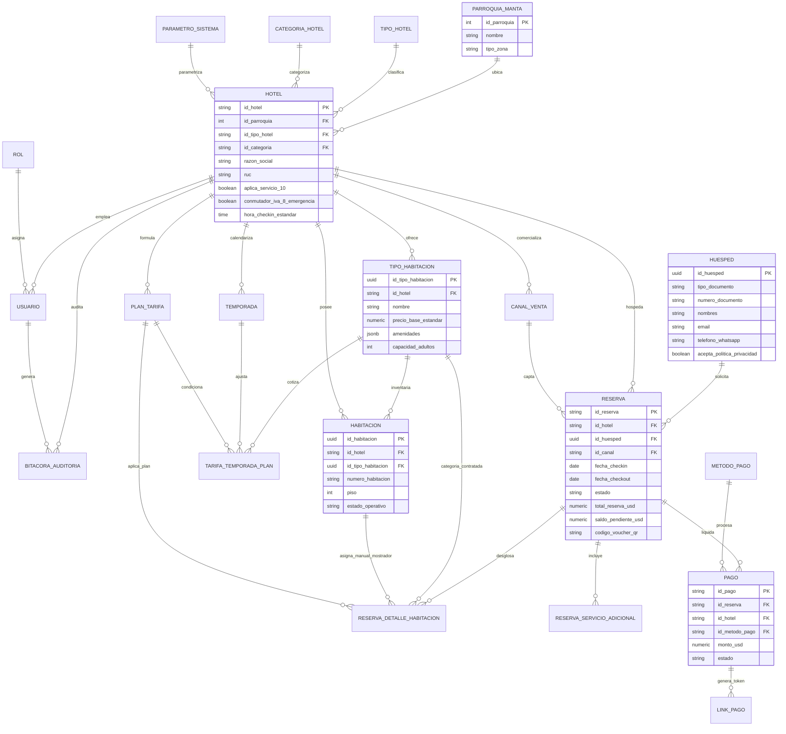

# Modelo y Arquitectura de Base de Datos
## Sistema de Gestión de Reservas y Alojamientos Hoteleros (Cantón Manta, Ecuador)

> **CUP Proyecto**: 91880000.0000.390820  
> **Alcance del Sistema**: Motor de reservas online para huéspedes, operativa ágil de mostrador (recepción), administración de cupos/tarifas comerciales (Revenue Management), procesamiento de pagos digitales locales y gobernanza cantonal para los 118 establecimientos de Manta.  
> **Alcance Específico**: Centralización de reservas online, liquidación y comprobantes de abonos mediante pasarelas digitales (PayPhone, DeUna, Kushki), control de disponibilidad por inventario y fechas, tarifas por temporadas, operativa ágil de check-in/out en recepción y gobernanza multi-tenant.
> **Estándar de Nomenclatura**: Todos los identificadores y claves primarias/foráneas comienzan con el prefijo estandarizado `id_`.

---

## 1. Diagrama Entidad-Relación (Mermaid ERD)

---

## 2. Estructura Modular y Convención `id_`

### Módulo 1: Catálogos Territoriales y Normativos
* `parroquia_manta`: `id_parroquia` (PK), nombre, tipo_zona (Urbana/Rural), codigo_postal.
* `tipo_hotel`: `id_tipo_hotel` (PK), denominacion (Hotel, Hostal, Hostería), descripcion, activo.
* `categoria_hotel`: `id_categoria` (PK), estrellas (1 a 5), denominacion.
* `parametro_sistema`: `id_parametro` (PK), valor, descripcion, es_editable, actualizado_en.

### Módulo 2: Hoteles y Multi-Tenant Cantonal
* `hotel`: `id_hotel` (PK), `id_parroquia` (FK), `id_tipo_hotel` (FK), `id_categoria` (FK), razon_social, nombre_comercial, ruc, email_contacto, telefono_contacto, direccion_matriz, direccion_establecimiento, aplica_servicio_10 (10% de propina turística en cotización Art. 41), conmutador_iva_8_emergencia (IVA reducido 8% en feriados turísticos), horarios de check-in/out, activo.

### Módulo 3: Seguridad, Roles RBAC y Trazabilidad
* `rol`: `id_rol` (PK: SUPERADMIN, ADMIN_HOTEL, REVENUE_MANAGER, RECEPCIONISTA, HUESPED), nombre, descripcion.
* `usuario`: `id_usuario` (PK), `id_hotel` (FK), `id_rol` (FK), identificacion, nombres, apellidos, email, password_hash, activo.
* `bitacora_auditoria`: `id_auditoria` (PK), `id_hotel` (FK), `id_usuario` (FK), accion, modulo, tabla_afectada, `id_registro`, datos_previos, datos_nuevos, direccion_ip, fecha_hora.

### Módulo 4: Habitaciones e Inventario
* `tipo_habitacion`: `id_tipo_habitacion` (PK), `id_hotel` (FK), codigo_interno, nombre, capacidad_adultos, capacidad_ninos, metraje_m2, tipo_cama, vista, precio_base_estandar, amenidades (JSONB), galeria_fotos_urls (JSONB).
* `habitacion`: `id_habitacion` (PK), `id_hotel` (FK), `id_tipo_habitacion` (FK), numero_habitacion, piso, estado_operativo (DISPONIBLE, OCUPADA, LIMPIEZA).

### Módulo 5: Tarifas, Temporadas y Canales
* `temporada`: `id_temporada` (PK), `id_hotel` (FK), nombre, fecha_inicio, fecha_fin, aplica_iva_8_decreto, multiplicador.
* `plan_tarifa`: `id_plan_tarifa` (PK), `id_hotel` (FK), codigo_plan, nombre, incluye_desayuno, es_reembolsable, recargo_descuento_porcentaje.
* `tarifa_temporada_plan`: `id_tarifa` (PK), `id_tipo_habitacion` (FK), `id_temporada` (FK), `id_plan_tarifa` (FK), precio_noche_usd.
* `canal_venta`: `id_canal` (PK), nombre, comision_porcentaje, es_directo.

### Módulo 6: Huéspedes y Protección de Datos (LOPDP)
* `huesped`: `id_huesped` (PK), tipo_documento, numero_documento, nombres, apellidos, email, telefono_whatsapp, direccion, acepta_politica_privacidad, fecha_consentimiento_lopdp, visitas_acumuladas.

### Módulo 7: Reservas y Operación de Mostrador
* `reserva`: `id_reserva` (PK), `id_hotel` (FK), `id_huesped` (FK), `id_canal` (FK), fecha_checkin, fecha_checkout, numero_noches, adultos, ninos, estado, subtotal_hospedaje_usd, base_imponible_total, porcentaje_iva_aplicado, monto_iva_usd, aplico_tasa_servicio_10, monto_servicio_10_usd, total_reserva_usd, saldo_pendiente_usd, codigo_voucher_qr, `id_recepcionista_checkin` (FK), `id_recepcionista_checkout` (FK).
* `reserva_detalle_habitacion`: `id_reserva_detalle` (PK), `id_reserva` (FK), `id_tipo_habitacion` (FK), `id_plan_tarifa` (FK), `id_habitacion` (FK asignada manualmente por recepción en mostrador), `id_usuario_asigna` (FK), tarifa_noche_pactada, subtotal_habitacion.
* `reserva_servicio_adicional`: `id_servicio_adicional` (PK), `id_reserva` (FK), tipo_servicio, descripcion, costo_usd, es_cortesia.

### Módulo 8: Pagos Digitales y Enlaces Seguros
* `metodo_pago`: `id_metodo_pago` (PK: PAYPHONE_EC, DEUNA_PICHINCHA, TRANSFERENCIA, TARJETA_POS, EFECTIVO), nombre, tipo_procesamiento.
* `pago`: `id_pago` (PK), `id_reserva` (FK), `id_hotel` (FK), `id_metodo_pago` (FK), monto_usd, fecha_pago, estado, referencia_transaccion_externa, respuesta_pasarela_payload (JSONB).
* `link_pago`: `id_link_pago` (PK), `id_pago` (FK), token_hash, url_acceso_seguro, monto_usd, telefono_destino_whatsapp, expira_en, estado.

---

## 3. Justificación del Motor de Base de Datos: PostgreSQL 16+

1. **Aislamiento Multi-Tenant con Row Level Security (RLS):** Garantiza que los 118 establecimientos de Manta compartan un esquema unificado de alto rendimiento sin riesgo de contaminación cruzada de reservas o clientes.
2. **Prevención Robusta de Overbooking:** Transacciones ACID atómicas con bloqueos pesimistas (`SELECT ... FOR UPDATE`) y exclusión de rangos de fechas (`EXCLUDE USING gist`) para reservar cupos sin sobreventa.
3. **Manejo Nativo de JSONB:** Permite búsquedas veloces mediante índices GIN sobre amenidades de habitaciones y almacenamiento de payloads de pasarelas de pago.
4. **Eficiencia en Costos:** Licencia 100% Open Source libre de costos por núcleo o por usuario.
