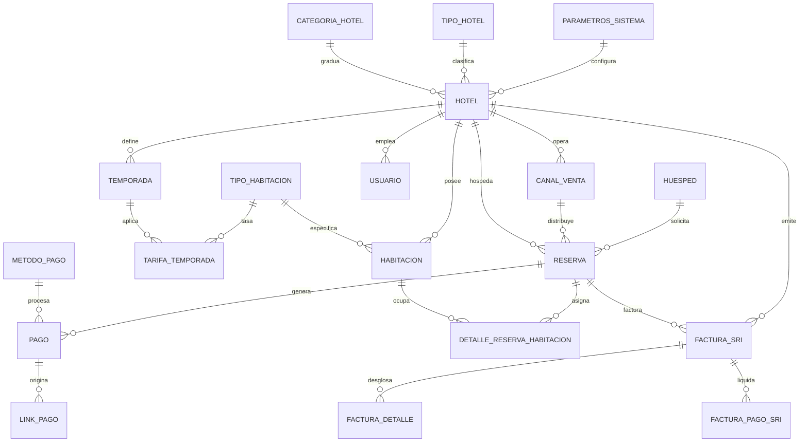

# Modelo y Arquitectura de Base de Datos
## Sistema de Gestión, Administración y Reservas Hoteleras (Cantón Manta, Ecuador)

> **CUP Proyecto**: 91880000.0000.390820  
> **Objetivo**: Sistema integral de gestión hotelera multihotel, motor de reservas web, administración de cupos/tarifas, cobros digitales y facturación electrónica autorizada ante el SRI para el cantón Manta, Ecuador.

---

## 1. Diagrama Entidad-Relación (Mermaid ERD)



---

## 2. Estructura Modular de Tablas

### Módulo 1: Parámetros Generales y Clasificación
* `parametro_general`: Configuraciones del sistema, impuestos vigentes (IVA 15%), endpoint Web Service SRI, claves maestras.
* `tipo_hotel`: Tipos de establecimiento turístico según el Ministerio de Turismo (Hotel, Hostal, Hostería, Resort, Pensión).
* `categoria_hotel`: Categorización de estrellas (1, 2, 3, 4, 5 estrellas o categoría especial).
* `catalogo_sri_pago`: Catálogo oficial de formas de pago del SRI (01 Sin utilización sistema financiero, 19 Tarjeta de crédito, 20 Otros con utilización sistema financiero, etc.).

### Módulo 2: Hoteles y Emisores SRI
* `hotel`: Entidad central multihotel. Almacena Razón Social, RUC de 13 dígitos, Nombre Comercial, Establecimiento (`001`), Punto de Emisión (`002`), Dirección Matriz, Sucursal, Obligado a Contabilidad, Régimen (General / RIMPE), Agente de Retención, Teléfono, Correo y `grava_servicio_10` (parámetro booleano para activar o desactivar el 10% de propina legal según Art. 41 Ley de Turismo).

### Módulo 3: Habitaciones e Inventario
* `tipo_habitacion`: Categoría de habitación (Individual Vista Mar, Doble Estándar Balcón, Doble Superior, Suite Panorámica, Villa Familiar). Capacidad de adultos, niños, amenidades en JSONB.
* `habitacion`: Unidades físicas numeradas (ej. 101, 202, 305), piso, estado operativo (`disponible`, `ocupada`, `mantenimiento`, `limpieza`), hotel_id.

### Módulo 4: Tarifas, Temporadas y Comisiones
* `temporada`: Temporadas del hotel (Baja, Media, Alta, Feriados de Carnaval/Fin de año) con multiplicador y rango de meses.
* `tarifa_temporada`: Matriz de precios por hotel, tipo de habitación y temporada.
* `canal_venta`: Canales de distribución (Directo, Booking.com, Expedia, Airbnb, DeUna) con porcentaje de comisión contractual.

### Módulo 5: Huéspedes y Perfiles
* `huesped`: Identificación (`tipo_identificacion`: C.I. ecuatoriana de 10 dígitos, RUC de 13 dígitos o Pasaporte), nombres, apellidos, correo, teléfono WhatsApp, país, ciudad, historial de visitas y notas.

### Módulo 6: Reservas y Estadía
* `reserva`: Código único (`RES-CS-001`), hotel_id, huesped_id, canal_id, fecha de check-in, fecha de check-out, número de noches, adultos, niños, total estimado, estado (`confirmada`, `checkin`, `checkout`, `cancelada`).
* `reserva_habitacion`: Detalle de habitaciones asignadas, tarifa pactada por noche y precio unitario.

### Módulo 7: Pagos y Enlaces de Cobro Seguro
* `metodo_pago`: Catálogo de medios de pago (PayPhone Ecuador, Kushki, Datafast, DeUna Banco Pichincha, Placetopay, Efectivo, Transferencia).
* `pago`: Registros de cobranza, id de transacción externa, valor en USD, estado (`completado`, `pendiente`, `fallido`).
* `link_pago`: Enlaces únicos autogenerados (`https://pago.hoteldirekt.ec/pay/...`), token hash, fecha de expiración (24h/48h/7d), WhatsApp de envío, QR data y estado.

### Módulo 8: Facturación Electrónica SRI (Ecuador)
* `factura_sri`: 
  * `numero_factura`: Formato SRI `001-002-000000001` (Establecimiento - Punto emisión - Secuencial).
  * `clave_acceso`: 49 dígitos numéricos calculados con algoritmo oficial Módulo 11 del SRI.
  * `numero_autorizacion`: 49 dígitos asignados por el SRI.
  * `fecha_autorizacion`: Timestamp de respuesta del SRI.
  * `ambiente`: `2` (Producción) o `1` (Pruebas).
  * `tipo_emision`: `1` (Normal).
  * `subtotal_15`: Base gravada con tarifa vigente del 15%.
  * `subtotal_0`: Base tarifa 0%.
  * `subtotal_no_objeto`: Base no objeto de IVA.
  * `subtotal_exento`: Base exenta de IVA.
  * `subtotal_sin_impuestos`: Suma de bases imponibles.
  * `total_descuento`: Descuento aplicado.
  * `iva_15`: Monto liquidado de IVA 15%.
  * `propina`: 10% de servicio turístico si aplica.
  * `valor_total`: Monto total en USD.
  * `estado_sri`: `AUTORIZADO`, `PENDIENTE`, `RECHAZADO`.
  * `xml_firmado`: Contenido XML firmado electrónicamente según esquema XSD del SRI.
* `factura_detalle`: Líneas de ítems facturados (código principal `HOS-001`, cantidad, descripción, precio unitario, descuento, precio total).
* `factura_pago_sri`: Relación con el catálogo SRI de formas de pago (código SRI, total, plazo, unidad de tiempo).

---

## 3. Script SQL DDL Completo (PostgreSQL / MySQL)

```sql
-- =============================================================================
-- ESQUEMA DE BASE DE DATOS: SISTEMA DE GESTIÓN Y RESERVAS HOTELERAS
-- CANTÓN MANTA, ECUADOR
-- =============================================================================

-- Habilitar extensión para UUIDs (en PostgreSQL)
CREATE EXTENSION IF NOT EXISTS "uuid-ossp";

-- -----------------------------------------------------------------------------
-- 1. TABLAS DE PARÁMETROS GENERALES Y CLASIFICACIONES
-- -----------------------------------------------------------------------------

CREATE TABLE parametro_general (
    parametro_id VARCHAR(50) PRIMARY KEY,
    nombre VARCHAR(100) NOT NULL,
    valor TEXT NOT NULL,
    descripcion TEXT,
    es_editable BOOLEAN DEFAULT TRUE,
    actualizado_en TIMESTAMP WITH TIME ZONE DEFAULT CURRENT_TIMESTAMP
);

CREATE TABLE tipo_hotel (
    tipo_hotel_id VARCHAR(30) PRIMARY KEY,
    nombre VARCHAR(80) NOT NULL, -- Hotel, Hostal, Resort, Hostería, Lodge, Pensión
    descripcion TEXT,
    activo BOOLEAN DEFAULT TRUE
);

CREATE TABLE categoria_hotel (
    categoria_id VARCHAR(30) PRIMARY KEY,
    estrellas INT CHECK (estrellas BETWEEN 1 AND 5),
    denominacion VARCHAR(50) NOT NULL -- 1 Estrella, 2 Estrellas, 3 Estrellas, 4 Estrellas, 5 Estrellas
);

CREATE TABLE catalogo_sri_pago (
    codigo_sri VARCHAR(5) PRIMARY KEY, -- '01', '19', '20', etc.
    descripcion VARCHAR(120) NOT NULL,
    requiere_plazo BOOLEAN DEFAULT FALSE
);

-- -----------------------------------------------------------------------------
-- 2. HOTELES Y ENTIDADES EMISORAS SRI
-- -----------------------------------------------------------------------------

CREATE TABLE hotel (
    hotel_id VARCHAR(50) PRIMARY KEY,
    tipo_hotel_id VARCHAR(30) REFERENCES tipo_hotel(tipo_hotel_id),
    categoria_id VARCHAR(30) REFERENCES categoria_hotel(categoria_id),
    nombre_comercial VARCHAR(150) NOT NULL,
    razon_social VARCHAR(150) NOT NULL,
    ruc CHAR(13) NOT NULL UNIQUE,
    establecimiento CHAR(3) NOT NULL DEFAULT '001',
    punto_emision CHAR(3) NOT NULL DEFAULT '001',
    dir_matriz VARCHAR(255) NOT NULL,
    dir_sucursal VARCHAR(255) NOT NULL,
    ciudad VARCHAR(80) NOT NULL DEFAULT 'Manta',
    provincia VARCHAR(80) NOT NULL DEFAULT 'Manabí',
    pais VARCHAR(50) NOT NULL DEFAULT 'Ecuador',
    telefono VARCHAR(30),
    email_contacto VARCHAR(100),
    obligado_contabilidad BOOLEAN NOT NULL DEFAULT TRUE,
    contribuyente_especial VARCHAR(50),
    regimen_tributario VARCHAR(80) DEFAULT 'CONTRIBUYENTE RÉGIMEN GENERAL',
    agente_retencion_resolucion VARCHAR(50),
    grava_servicio_10 BOOLEAN NOT NULL DEFAULT FALSE, -- Art. 41 Ley de Turismo: TRUE aplica 10% propina, FALSE exento
    moneda VARCHAR(5) DEFAULT 'USD',
    estado VARCHAR(20) DEFAULT 'activo' CHECK (estado IN ('activo', 'pausado', 'inactivo')),
    creado_en TIMESTAMP WITH TIME ZONE DEFAULT CURRENT_TIMESTAMP
);

-- -----------------------------------------------------------------------------
-- 3. TIPOS DE HABITACIÓN Y HABITACIONES FÍSICAS
-- -----------------------------------------------------------------------------

CREATE TABLE tipo_habitacion (
    tipo_habitacion_id UUID PRIMARY KEY DEFAULT uuid_generate_v4(),
    hotel_id VARCHAR(50) REFERENCES hotel(hotel_id) ON DELETE CASCADE,
    codigo VARCHAR(30) NOT NULL,
    nombre VARCHAR(100) NOT NULL, -- Ej: Doble Estándar Balcón
    precio_base NUMERIC(10,2) NOT NULL,
    capacidad_adultos INT NOT NULL DEFAULT 2,
    capacidad_ninos INT NOT NULL DEFAULT 0,
    icono VARCHAR(30) DEFAULT '🛏️',
    amenidades JSONB, -- ["WiFi", "Vista al mar", "Aire Acondicionado"]
    activo BOOLEAN DEFAULT TRUE,
    UNIQUE(hotel_id, codigo)
);

CREATE TABLE habitacion (
    habitacion_id UUID PRIMARY KEY DEFAULT uuid_generate_v4(),
    hotel_id VARCHAR(50) REFERENCES hotel(hotel_id) ON DELETE CASCADE,
    tipo_habitacion_id UUID REFERENCES tipo_habitacion(tipo_habitacion_id),
    numero VARCHAR(10) NOT NULL,
    piso INT NOT NULL DEFAULT 1,
    estado VARCHAR(20) NOT NULL DEFAULT 'disponible' 
        CHECK (estado IN ('disponible', 'ocupada', 'mantenimiento', 'limpieza')),
    notas_operativas TEXT,
    UNIQUE(hotel_id, numero)
);

-- -----------------------------------------------------------------------------
-- 5. TEMPORADAS, TARIFAS Y COMISIONES POR CANAL
-- -----------------------------------------------------------------------------

CREATE TABLE temporada (
    temporada_id UUID PRIMARY KEY DEFAULT uuid_generate_v4(),
    hotel_id VARCHAR(50) REFERENCES hotel(hotel_id) ON DELETE CASCADE,
    nombre VARCHAR(80) NOT NULL, -- Temporada Baja, Media, Alta
    meses_descripcion VARCHAR(120) NOT NULL,
    multiplicador NUMERIC(4,2) NOT NULL DEFAULT 1.00,
    color_hex VARCHAR(10) DEFAULT '#064e3b',
    activo BOOLEAN DEFAULT TRUE
);

CREATE TABLE tarifa_temporada (
    tarifa_id UUID PRIMARY KEY DEFAULT uuid_generate_v4(),
    tipo_habitacion_id UUID REFERENCES tipo_habitacion(tipo_habitacion_id) ON DELETE CASCADE,
    temporada_id UUID REFERENCES temporada(temporada_id) ON DELETE CASCADE,
    precio_calculado NUMERIC(10,2) NOT NULL,
    UNIQUE(tipo_habitacion_id, temporada_id)
);

CREATE TABLE canal_venta (
    canal_id VARCHAR(40) PRIMARY KEY,
    hotel_id VARCHAR(50) REFERENCES hotel(hotel_id) ON DELETE CASCADE,
    nombre VARCHAR(80) NOT NULL, -- Directo, Booking.com, Expedia, Airbnb
    comision_porcentaje NUMERIC(5,2) NOT NULL DEFAULT 0.00,
    color_hex VARCHAR(10) DEFAULT '#6ee7b7',
    es_directo BOOLEAN DEFAULT FALSE
);

-- -----------------------------------------------------------------------------
-- 6. HUÉSPEDES
-- -----------------------------------------------------------------------------

CREATE TABLE huesped (
    huesped_id UUID PRIMARY KEY DEFAULT uuid_generate_v4(),
    hotel_id VARCHAR(50) REFERENCES hotel(hotel_id),
    tipo_documento VARCHAR(10) NOT NULL DEFAULT 'CI' CHECK (tipo_documento IN ('CI', 'RUC', 'PASAPORTE')),
    numero_documento VARCHAR(20) NOT NULL,
    nombres VARCHAR(100) NOT NULL,
    apellidos VARCHAR(100) NOT NULL,
    email VARCHAR(120),
    telefono_whatsapp VARCHAR(30),
    pais_origen VARCHAR(60) DEFAULT 'Ecuador',
    ciudad VARCHAR(80),
    direccion VARCHAR(255),
    notas_preferencias TEXT,
    visitas_totales INT DEFAULT 1,
    gasto_acumulado_usd NUMERIC(12,2) DEFAULT 0,
    -- Cumplimiento de la Ley Orgánica de Protección de Datos Personales (LOPDP Ecuador)
    acepta_lopdp BOOLEAN NOT NULL DEFAULT TRUE,
    fecha_consentimiento_lopdp TIMESTAMP WITH TIME ZONE DEFAULT CURRENT_TIMESTAMP,
    creado_en TIMESTAMP WITH TIME ZONE DEFAULT CURRENT_TIMESTAMP,
    UNIQUE(hotel_id, numero_documento)
);

-- -----------------------------------------------------------------------------
-- 7. RESERVAS
-- -----------------------------------------------------------------------------

CREATE TABLE reserva (
    reserva_id VARCHAR(30) PRIMARY KEY, -- 'RES-CS-101'
    hotel_id VARCHAR(50) NOT NULL REFERENCES hotel(hotel_id),
    huesped_id UUID NOT NULL REFERENCES huesped(huesped_id),
    canal_id VARCHAR(40) REFERENCES canal_venta(canal_id),
    check_in DATE NOT NULL,
    check_out DATE NOT NULL,
    numero_noches INT NOT NULL,
    adultos INT NOT NULL DEFAULT 1,
    ninos INT NOT NULL DEFAULT 0,
    total_estadia_usd NUMERIC(10,2) NOT NULL,
    estado VARCHAR(20) NOT NULL DEFAULT 'confirmada' 
        CHECK (estado IN ('confirmada', 'pending', 'checkin', 'checkout', 'cancelada')),
    origen VARCHAR(50) DEFAULT 'Directo',
    observaciones TEXT,
    creada_en TIMESTAMP WITH TIME ZONE DEFAULT CURRENT_TIMESTAMP
);

CREATE TABLE reserva_habitacion (
    id UUID PRIMARY KEY DEFAULT uuid_generate_v4(),
    reserva_id VARCHAR(30) REFERENCES reserva(reserva_id) ON DELETE CASCADE,
    habitacion_id UUID REFERENCES habitacion(habitacion_id),
    precio_noche_pactado NUMERIC(10,2) NOT NULL
);

-- -----------------------------------------------------------------------------
-- 8. PAGOS Y LINKS DE PAGO
-- -----------------------------------------------------------------------------

CREATE TABLE metodo_pago (
    metodo_id VARCHAR(40) PRIMARY KEY,
    nombre VARCHAR(80) NOT NULL, -- PayPhone, Kushki, Datafast, DeUna, Efectivo
    tipo VARCHAR(30) NOT NULL, -- pasarela_online, transferencia, pos, efectivo
    activo BOOLEAN DEFAULT TRUE
);

CREATE TABLE pago (
    pago_id VARCHAR(30) PRIMARY KEY, -- 'PAY-CS-201'
    reserva_id VARCHAR(30) REFERENCES reserva(reserva_id),
    hotel_id VARCHAR(50) REFERENCES hotel(hotel_id),
    metodo_id VARCHAR(40) REFERENCES metodo_pago(metodo_id),
    monto_usd NUMERIC(10,2) NOT NULL,
    fecha_pago DATE NOT NULL DEFAULT CURRENT_DATE,
    estado VARCHAR(20) NOT NULL DEFAULT 'pending' CHECK (estado IN ('completed', 'pending', 'failed')),
    concepto VARCHAR(200),
    transaccion_externa_id VARCHAR(100),
    creado_en TIMESTAMP WITH TIME ZONE DEFAULT CURRENT_TIMESTAMP
);

CREATE TABLE link_pago (
    link_id UUID PRIMARY KEY DEFAULT uuid_generate_v4(),
    pago_id VARCHAR(30) REFERENCES pago(pago_id) ON DELETE CASCADE,
    token_url VARCHAR(64) NOT NULL UNIQUE,
    url_completa VARCHAR(255) NOT NULL,
    monto_usd NUMERIC(10,2) NOT NULL,
    huesped_nombre VARCHAR(150) NOT NULL,
    whatsapp_destino VARCHAR(30),
    email_destino VARCHAR(120),
    pasarela_preferida VARCHAR(50) DEFAULT 'payphone',
    expira_en TIMESTAMP WITH TIME ZONE NOT NULL,
    estado VARCHAR(20) DEFAULT 'activo' CHECK (estado IN ('activo', 'pagado', 'expirado', 'cancelado')),
    creado_en TIMESTAMP WITH TIME ZONE DEFAULT CURRENT_TIMESTAMP
);

-- -----------------------------------------------------------------------------
-- 9. FACTURACIÓN ELECTRÓNICA SRI ECUADOR (IVA 15%)
-- -----------------------------------------------------------------------------

CREATE TABLE factura_sri (
    factura_id UUID PRIMARY KEY DEFAULT uuid_generate_v4(),
    hotel_id VARCHAR(50) NOT NULL REFERENCES hotel(hotel_id),
    reserva_id VARCHAR(30) REFERENCES reserva(reserva_id),
    huesped_id UUID NOT NULL REFERENCES huesped(huesped_id),
    
    -- Identificadores SRI
    establecimiento CHAR(3) NOT NULL,
    punto_emision CHAR(3) NOT NULL,
    secuencial CHAR(9) NOT NULL,
    numero_factura_completo VARCHAR(20) NOT NULL UNIQUE, -- '001-002-000000001'
    clave_acceso CHAR(49) NOT NULL UNIQUE,
    numero_autorizacion CHAR(49) NOT NULL,
    fecha_hora_autorizacion TIMESTAMP WITH TIME ZONE NOT NULL,
    
    ambiente CHAR(1) NOT NULL DEFAULT '2', -- 1: Pruebas, 2: Producción
    tipo_emision CHAR(1) NOT NULL DEFAULT '1', -- 1: Normal
    fecha_emision DATE NOT NULL,
    
    -- Desglose oficial de impuestos SRI Ecuador
    subtotal_15 NUMERIC(12,2) NOT NULL DEFAULT 0.00,
    subtotal_0 NUMERIC(12,2) NOT NULL DEFAULT 0.00,
    subtotal_no_objeto NUMERIC(12,2) NOT NULL DEFAULT 0.00,
    subtotal_exento NUMERIC(12,2) NOT NULL DEFAULT 0.00,
    subtotal_sin_impuestos NUMERIC(12,2) NOT NULL DEFAULT 0.00,
    total_descuento NUMERIC(12,2) NOT NULL DEFAULT 0.00,
    ice NUMERIC(12,2) NOT NULL DEFAULT 0.00,
    iva_15 NUMERIC(12,2) NOT NULL DEFAULT 0.00,
    propina_servicio NUMERIC(12,2) NOT NULL DEFAULT 0.00,
    valor_total_usd NUMERIC(12,2) NOT NULL,
    
    estado_pago VARCHAR(20) DEFAULT 'paid' CHECK (estado_pago IN ('paid', 'pending', 'overdue', 'refunded')),
    estado_sri VARCHAR(20) DEFAULT 'AUTORIZADO' CHECK (estado_sri IN ('AUTORIZADO', 'PENDIENTE', 'DEVUELTA', 'ERROR')),
    xml_firmado TEXT,
    pdf_ride_url VARCHAR(255),
    creado_en TIMESTAMP WITH TIME ZONE DEFAULT CURRENT_TIMESTAMP
);

CREATE TABLE factura_detalle (
    detalle_id UUID PRIMARY KEY DEFAULT uuid_generate_v4(),
    factura_id UUID REFERENCES factura_sri(factura_id) ON DELETE CASCADE,
    codigo_principal VARCHAR(30) NOT NULL DEFAULT 'HOS-001',
    descripcion VARCHAR(255) NOT NULL,
    cantidad NUMERIC(8,2) NOT NULL DEFAULT 1.00,
    precio_unitario NUMERIC(10,2) NOT NULL,
    descuento NUMERIC(10,2) NOT NULL DEFAULT 0.00,
    precio_total NUMERIC(12,2) NOT NULL,
    tarifa_iva NUMERIC(4,2) NOT NULL DEFAULT 15.00
);

CREATE TABLE factura_pago_sri (
    id UUID PRIMARY KEY DEFAULT uuid_generate_v4(),
    factura_id UUID REFERENCES factura_sri(factura_id) ON DELETE CASCADE,
    codigo_sri VARCHAR(5) REFERENCES catalogo_sri_pago(codigo_sri),
    total_usd NUMERIC(12,2) NOT NULL,
    plazo INT DEFAULT 0,
    unidad_tiempo VARCHAR(20) DEFAULT 'dias'
);

-- -----------------------------------------------------------------------------
-- 10. USUARIOS, ROLES Y ACCESOS
-- -----------------------------------------------------------------------------

CREATE TABLE usuario (
    usuario_id VARCHAR(50) PRIMARY KEY,
    nombre VARCHAR(100) NOT NULL,
    email VARCHAR(120) NOT NULL UNIQUE,
    telefono VARCHAR(30),
    password_hash VARCHAR(255) NOT NULL,
    rol VARCHAR(20) NOT NULL CHECK (rol IN ('superadmin', 'admin', 'manager', 'receptionist')),
    estado VARCHAR(20) DEFAULT 'active' CHECK (estado IN ('active', 'invited', 'blocked')),
    ultimo_acceso TIMESTAMP WITH TIME ZONE,
    creado_en TIMESTAMP WITH TIME ZONE DEFAULT CURRENT_TIMESTAMP
);

CREATE TABLE usuario_hotel_acceso (
    usuario_id VARCHAR(50) REFERENCES usuario(usuario_id) ON DELETE CASCADE,
    hotel_id VARCHAR(50) REFERENCES hotel(hotel_id) ON DELETE CASCADE,
    PRIMARY KEY (usuario_id, hotel_id)
);

-- -----------------------------------------------------------------------------
-- ÍNDICES ESTRATÉGICOS PARA MÁXIMO RENDIMIENTO
-- -----------------------------------------------------------------------------

CREATE INDEX idx_habitacion_hotel_estado ON habitacion(hotel_id, estado);
CREATE INDEX idx_reserva_fechas ON reserva(hotel_id, check_in, check_out);
CREATE INDEX idx_pago_hotel_fecha ON pago(hotel_id, fecha_pago, estado);
CREATE INDEX idx_factura_clave_acceso ON factura_sri(clave_acceso);
CREATE INDEX idx_factura_hotel_secuencial ON factura_sri(hotel_id, establecimiento, punto_emision, secuencial);
CREATE INDEX idx_link_pago_token ON link_pago(token_url);
```
